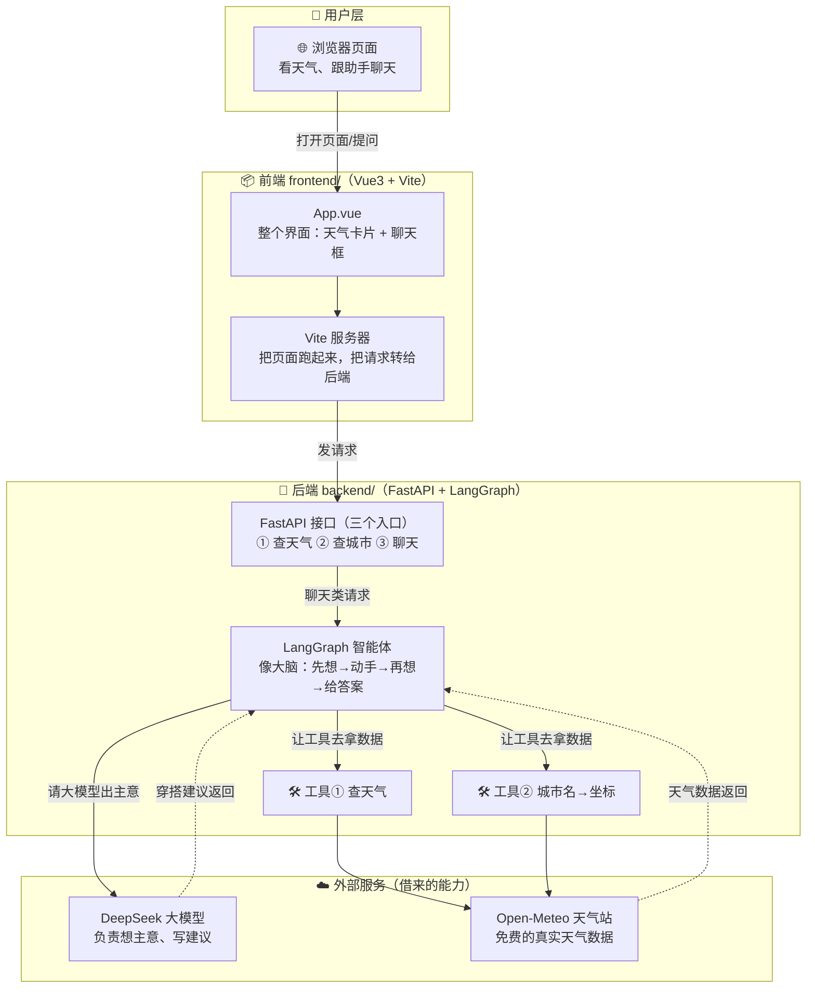
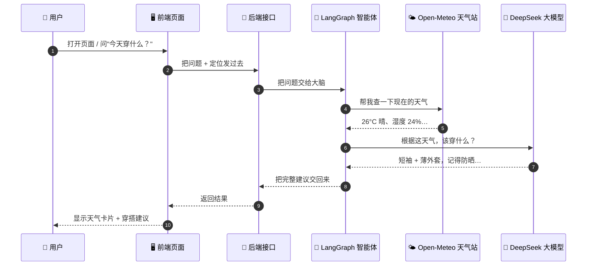
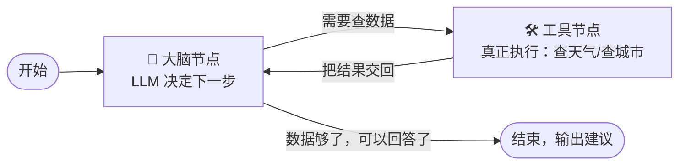

# 天气穿搭助手（LangChain + LangGraph 学习 Demo）

一个"推送当天天气 + 穿搭/出门建议"的 AI 助理。后端用 **FastAPI + LangGraph**，
前端用 **Vue3 + Vite**。天气数据来自 Open-Meteo（免费、免 key），建议由 LLM 生成。

## 架构总览

### ① 整体架构图（谁和谁有关系）



> 一句话：**浏览器 ↔ 前端页面 ↔ 后端大脑 ↔（天气站 + 大模型）**。
> 前端只负责"长什么样、跟人交互"；后端负责"动脑筋、拿数据"；真实天气和智能建议都来自外面的两个服务。

### ② 一次提问的完整旅程（数据怎么流转）



> 关键点：**大脑（LangGraph）不是一次就答完**，而是"先叫工具查数据 → 拿到数据 → 再请大模型组织语言 → 最后回答"，中间可以来回好几轮（这就是它和普通程序最大的区别）。

### ③ 智能体内部的小循环（进阶）



## 目录结构

```
backend/
  main.py            # 全部后端：天气工具 + LangGraph 智能体 + FastAPI + 每日推送 + 伺服前端
  push_once.py       # 一次性推送脚本：GitHub Actions 定时任务的入口
  settings.json      # 运行时生成：默认城市 / 收件邮箱 / 推送时间
  requirements.txt
  .env.example       # 复制成 .env：填 DeepSeek key 和 SMTP 发信账号
frontend/
  src/App.vue        # 全部前端：天气卡片 + 对话 + 设置弹窗，单文件
  vite.config.js     # 本地开发时 /api 代理到后端 8000（生产同域，不需要）
Dockerfile           # 一个镜像装下前后端，给 Render 用
render.yaml          # Render 蓝图，一键建服务
.github/workflows/
  daily-push.yml     # 每天北京时间 07:00 自动推送
```

## 快速开始

```bash
# 1. 后端
cd backend
python -m venv .venv
.venv\Scripts\python -m pip install -r requirements.txt   # Windows
copy .env.example .env                                    # 填入 DEEPSEEK_API_KEY
.venv\Scripts\python main.py                              # 启动 http://127.0.0.1:8000

# 2. 前端（另开一个终端）
cd frontend
npm install
node node_modules/vite/bin/vite.js                        # 打开 http://localhost:5173
```

> ⚠️ 当前项目路径含 `&`（`lanchain&langraph`），Windows 的 `npm run dev` 会把它当命令分隔符
> 而报 `Cannot find module ... vite\bin\vite.js`。两种解法任选：
> - 用上面的 `node node_modules/vite/bin/vite.js` 直接启动（绕开 npm 的 cmd 壳）；
> - 或把整个项目复制到一个不含 `&`、不含空格的目录（如 `F:\code\weather-demo`），即可正常 `npm run dev`。

页面加载会用设置里的默认城市（默认 **珠海**）拉取天气卡片并"推送"一条今日穿搭建议；
也可以手动输城市切换、点 📍 用浏览器定位，或在对话框追问（"明天呢？"会沿用上下文）。

## 每日邮件推送

每天早上（默认 **07:00**）自动把当天天气 + 穿搭/出门建议发到你邮箱，城市默认 **珠海**。

**怎么配置：**

1. 在 `backend/.env` 里填 SMTP 发信账号（`.env.example` 里有 QQ/163/Gmail/Outlook 的现成参数）：

   ```ini
   SMTP_HOST=smtp.qq.com
   SMTP_PORT=465
   SMTP_USER=你的邮箱@qq.com
   SMTP_PASS=你的SMTP授权码     # 注意：是"授权码"，不是邮箱登录密码
   ```

   > QQ 邮箱：设置 → 账户 → 开启「IMAP/SMTP 服务」→ 生成授权码。
   > 163 邮箱：设置 → POP3/SMTP/IMAP → 开启服务 → 获取授权码。

2. 启动后端，打开网页，点右上角 **⚙️** 填写「默认城市 / 收件邮箱 / 推送时间」，保存。
3. 点 **📨 立即推送测试** 验证配置对不对，成功会提示"已推送到 xxx@xx.com"。

**它是怎么实现的**（不引第三方调度库）：

- `settings.json` 存用户设置，`load_settings()` / `save_settings()` 读写；
- `daily_push_loop()` 是个 asyncio 任务，算出到下一个推送时间的秒数，`await asyncio.sleep(...)`
  睡到点，然后调 `run_push()`；在 FastAPI 的 `lifespan` 里随服务启动/停止；
- `run_push()` 内部就跑一遍你已经在学的那个 LangGraph 智能体（`graph.ainvoke`），
  拿到建议后交给 `send_email()`（标准库 `smtplib`）发出。

> 注意：定时任务跑在**后端进程**里，所以后端要一直开着才会推送。想让它在没开电脑时也发，
> 得把后端部署到服务器或云函数上。

## 对 Java 同学：LangGraph 到底在干什么

`backend/main.py` 从下往上读，一共四层：

1. **天气数据层**（`_weather_payload` / `_geocode`）——纯 HTTP，等价于你调第三方 SDK。
2. **工具层**（`@tool`）——`@tool` 把普通函数"注册"给 LLM，签名和 docstring 会自动
   变成参数说明。类比 Java：接口方法 + 注解，由框架反射出参数元数据。
3. **图层**（`StateGraph`）——这是 LangGraph 的核心，一个带状态的有限状态机：

   ```
   START → agent ──有 tool_calls──▶ tools ──▶ 回到 agent
               └────无 tool_calls──▶ END
   ```

   - `State`（TypedDict）是状态，`add_messages` 是"归并器"：节点返回的消息追加进历史，不覆盖。
   - `agent` 节点：LLM 决定"调哪个工具、传什么参数"。
   - `tools` 节点（`ToolNode`）：真正执行函数，把结果写回 messages。
   - `should_continue` 条件边：看最后一条消息还有没有工具调用，决定继续循环还是结束。
   - `MemorySaver` checkpointer：按 `thread_id` 记住每段会话，所以"明天呢"能接上上下文。

   这个"LLM 出决策 → 执行工具 → 结果喂回 LLM → 再决策"的循环就是 **ReAct** 模式。
4. **HTTP 层**（FastAPI）——把上图包成一个 REST 服务，前端 `POST /api/chat` 就触发一次
   `graph.invoke(...)`。

## 换 LLM

DeepSeek 走的是 OpenAI 兼容协议，`main.py` 里用 `ChatOpenAI` + `base_url` 指向它。
换通义/智谱/Ollama 只改 `.env` 三个变量：

```ini
DEEPSEEK_API_KEY=你的key
DEEPSEEK_BASE_URL=https://api.deepseek.com/v1   # 改成对应服务地址
DEEPSEEK_MODEL=deepseek-chat                    # 改成对应模型名
```

## 部署到云端（白嫖方案）

要上云的是两样东西，各用各的免费方案，**都不用服务器、不用信用卡**：

| 部署什么 | 放哪 | 为什么这么放 |
|---|---|---|
| **每日 7 点推送** | GitHub Actions | 白送的 CI 机器，跑完就销毁，不需要任何服务器 |
| **网页**（前端 + 后端） | Render 免费档 | 一个 Docker 容器装下前后端，同域名同端口，真的就一台 |

> 推送为什么不放在网页那台机器上？因为 Render 免费实例**闲置 15 分钟就休眠**，
> 进程里的定时任务会跟着一起睡过去，早上 7 点大概率不会醒。
> GitHub Actions 是外部定时器，不受影响。

**建议先做「一」（推送）**，做完你就已经不漏推送了；网页随时可以再补。

### 一、每日推送 → GitHub Actions

入口脚本是 `backend/push_once.py`，它只做「生成建议 + 发邮件」，不需要起 HTTP 服务。
GitHub Actions 免费额度：公开仓库无限，私有仓库每月 2000 分钟（这任务每天 1 分钟，一月才 30 分钟）。

1. **建仓库**：GitHub 新建仓库，**选 Private**（私有仓库 Actions 同样免费，还不会暴露你的邮箱）。

2. **推代码**：

   ```bash
   cd "F:\code\was fun\lanchain&langraph"
   git init && git add . && git commit -m "天气穿搭助手"
   git remote add origin https://github.com/你的用户名/仓库名.git
   git push -u origin main
   ```

   > `.gitignore` 已经挡掉了 `backend/.env`（DeepSeek key + 邮箱授权码）。推之前 `git status`
   > 扫一眼，确认列表里**没有 `.env`**。

3. **配 Secrets**：仓库 → Settings → Secrets and variables → Actions → New repository secret，
   逐个添加（值就是 `backend/.env` 里的）：

   | Secret | 值 |
   |---|---|
   | `DEEPSEEK_API_KEY` | 你的 DeepSeek key |
   | `SMTP_HOST` | `smtp.qq.com` |
   | `SMTP_PORT` | `465` |
   | `SMTP_USER` | `2899964923@qq.com` |
   | `SMTP_PASS` | 你的 SMTP 授权码 |
   | `PUSH_CITY` | `珠海` |
   | `PUSH_EMAIL_TO` | `2899964923@qq.com` |

4. **测试**：仓库 → Actions → 左侧选「每日穿搭推送」→ 右侧 **Run workflow**。
   跑完查邮箱；之后每天北京时间 **07:00** 自动跑。

### 注意点

- GitHub cron 用 **UTC**：北京 07:00 要写 `0 23 * * *`（workflow 里已写好）。
- ⚠️ **GitHub 自带的定时器现在很不可靠**：2026-08 起大面积延迟甚至漏触发，本仓库实测**晚到 113 分钟**。
  所以现在的方案是「外部定时器准点触发 + GitHub cron 兜底」，见下一节。
- **公开仓库 60 天无提交会被自动停掉定时任务**（私有仓库没这限制）。真被停了，去 Actions 页面点 Enable。
- 想本地也保留定时：本地后端照旧跑着就行（但别和云端同时开，会重复发）。

### 一之二、让推送准点：外部定时器打 workflow_dispatch

GitHub 的 `schedule` 从 2026-08 起大面积延迟甚至完全漏触发，社区通用解法是**用外部定时器调 GitHub 的
`workflow_dispatch` API**，实测秒级触发。这里用 [cron-job.org](https://cron-job.org)（免费，邮箱注册即可，不要卡）。

**① 生成一个最小权限 token**（别用那种能操作所有仓库的经典 token）：

1. 打开 <https://github.com/settings/personal-access-tokens/new>
2. Token name 填 `cron-dispatch`，Expiration 建议 1 年
3. **Repository access** → Only select repositories → **只勾这一个仓库**
4. **Permissions → Repository permissions → Actions** → 设为 **Read and write**（其余全部保持 No access）
5. Generate token，复制 `github_pat_...`（只显示一次）

**② 在 cron-job.org 建任务**：

| 字段 | 值 |
|---|---|
| URL | `https://api.github.com/repos/<用户名>/<仓库名>/actions/workflows/daily-push.yml/dispatches` |
| Schedule | Every day at **07:00**，Timezone 必须选 **Asia/Shanghai** |
| Method | `POST` |
| Body | `{"ref":"main"}` |
| Header | `Authorization: Bearer github_pat_你的token` |
| Header | `Accept: application/vnd.github+json` |
| Header | `Content-Type: application/json` |

**成功标志**：HTTP **204**（无响应体）。建议顺手打开 cron-job.org 的失败邮件通知。

**③ 为什么不会一天收两封**：workflow 里加了判断——查「北京时间今天」有没有成功记录，有就跳过。
外部定时器先跑成功，GitHub 兜底那次会自动跳过；如果早上那次失败了，兜底那次会自动重试。
（`schedule` 触发的运行会先 `sleep 600`，避免两者在同一分钟撞车。）

### 二、网页 → Render（前后端同一个容器）

仓库里已经把部署文件准备好了，你不用改任何代码：

- `Dockerfile`：多阶段构建，Node 编译前端 → Python 跑后端并伺服前端静态文件；
- `render.yaml`：Render 蓝图，读它就能一键建好服务；
- `.dockerignore`：挡住 `.env` 等敏感文件，不会被打进镜像。

1. 代码先推到 GitHub（就是上面第 2 步那个仓库，同一个仓库就行）。
2. 打开 [dashboard.render.com](https://dashboard.render.com)，用 **GitHub 账号登录**（免费，不用绑卡）。
3. 点 **New → Blueprint** → 选中你的仓库 → Render 自动读取 `render.yaml`。
4. 它只会问你两个值（其余已在蓝图里写好）：
   - `DEEPSEEK_API_KEY`
   - `SMTP_PASS`
5. 点 **Apply**，等 3~5 分钟。构建完会给你一个 `https://xxx.onrender.com`，**前后端都在这个地址上**——
   页面和 API 同域，不用再配跨域。

**免费档的代价**：闲置 15 分钟休眠，下次打开要等 30~60 秒冷启动。个人用完全可以接受。

> 云上 `ENABLE_SCHEDULER=0`（蓝图里已设），意思是那台机器的进程内定时任务关掉了，
> 推送统一由 GitHub Actions 负责，避免早上 7 点收到两封。

**其他平台的取舍**：

- **Koyeb** 免费档已停止新用户注册，不用考虑了。
- **Hugging Face Spaces** 免费且支持 Docker，但国内访问不稳定，不推荐。
- **PythonAnywhere** 免费档外网有白名单，可能连不上 DeepSeek 和 Open-Meteo，别用。

## 已知边界（ponytail）

- 记忆存在内存（`MemorySaver`），后端重启即清空；要持久化换成 `SqliteSaver` 即可。
- 天气/地理用 Open-Meteo 免费接口，国内城市名中文解析偶尔不准，输拼音或换英文更稳。
- 前端 markdown 只支持 `**加粗**` 和换行，够看即可，要完整渲染再加 `marked`。
- 本地定时推送依赖后端进程常驻（`asyncio` 任务），关机就不会发；不想开机就发用上面的
  **GitHub Actions** 方案（`push_once.py`），两者可互换。
- 邮件是「HTML 卡片 + 纯文本兜底」双版本（`_email_html` / `_md_to_html`）；样式全部内联，
  因为各邮箱客户端对 `<style>` 块支持参差。
- `settings.json` 明文存城市/邮箱，无鉴权；这是单机 Demo，别把后端直接暴露到公网。
